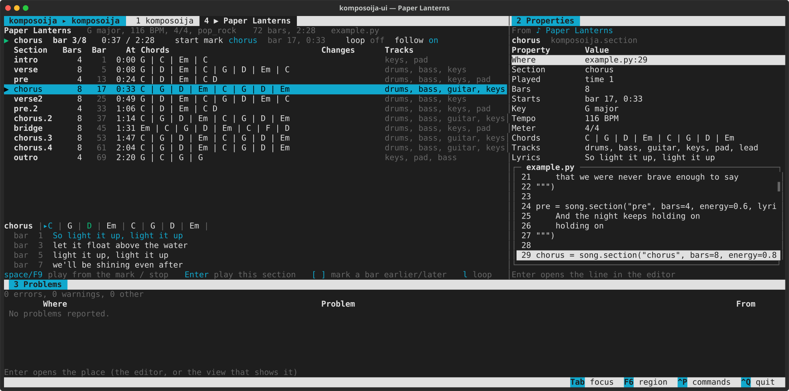
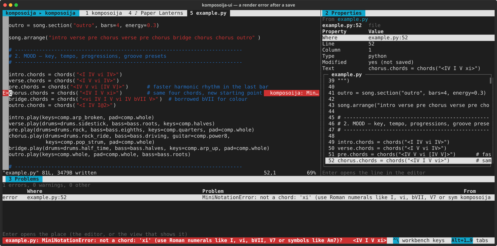
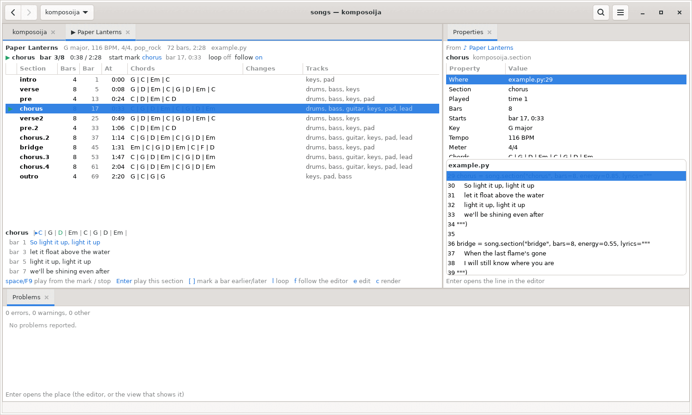
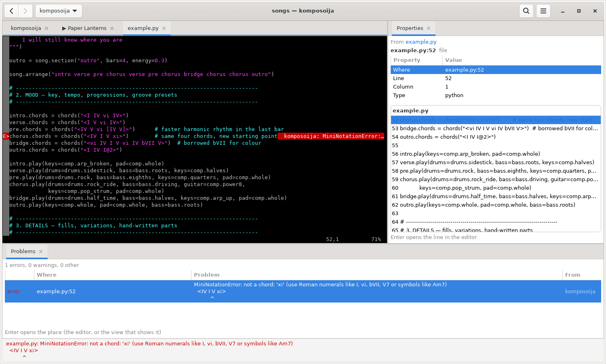

# komposoija

Interactive, AI-assisted song composition for pop/rock, jazz, blues, funk, reggae and metal.
Songs are written as code — Strudel-style patterns in Python — and rendered to multi-track
MIDI for band scores and SoundFont playback, plus WAV/MP3 audio.

```
lyrics ──► structure ──► mood ──► details ──► MIDI ──► scores / playback / MP3
           (agent+human)  (key, chords,  (fills, riffs,
                           grooves)       variants)
```

Each stage is a block in the song file, so you and an AI agent (Claude Code, guided by
`CLAUDE.md`) can edit it together and hear the result after every change.

```python
from komposoija import *

song = Song(title="Paper Lanterns", key="G major", tempo=116)
verse = song.section("verse", bars=8, lyrics="We wrote our names on paper lanterns ...")
chorus = song.section("chorus", bars=8, lyrics="So light it up, light it up ...")
song.arrange("verse chorus verse chorus chorus")

verse.chords = chords("<I V vi IV>")
chorus.chords = chords("<IV I V vi>")
verse.play(drums=drums.sidestick, bass=bass.roots, keys=comp.halves)
chorus.play(drums=drums.rock_ride, bass=bass.driving, guitar=comp.power8)
chorus.fill(drums=fill(drums.rock_ride, "full"))
```

## Setup

```bash
sudo apt install fluidsynth fluid-soundfont-gm lame     # audio (optional for MIDI-only use)
python3 -m venv .venv && .venv/bin/pip install -e '.[dev]'
```

## Usage

```bash
.venv/bin/komposoija render songs/example.py                  # -> build/example.mid + summary
.venv/bin/komposoija render songs/example.py --watch --play   # live coding with playback
.venv/bin/komposoija render songs/example.py -w --play --from chorus.2   # ... from a place
.venv/bin/komposoija render songs/example.py --mp3            # -> build/example.mp3
.venv/bin/komposoija show songs/example.py                    # arrangement overview
.venv/bin/pytest -q                                           # tests
```

## In the myrcp workbench

komposoija has a user interface on [myrcp](https://github.com/saperant/myrcp), a
terminal-first workbench (or a GTK 4 one): edit the song in Vim/Neovim on one side, see
its form and a playhead on the other. The editor's cursor sets where playing starts (the
section, and on a lyric line its bar); `F9` plays from there, `space` in the song's tab,
`l` loops the section, and a save replays the new version. Render errors are in Problems
at their line. See "In the myrcp workbench" in the [DSL reference](docs/song-dsl.md).

```bash
.venv/bin/pip install -e '.[ui]'              # the myrcp wheel from PyPI comes along
cd songs && ../.venv/bin/komposoija-ui        # the songs below the current directory
MYRCP_GTK=1 .venv/bin/komposoija-ui           # the GTK workbench (a myrcp-gtk built from source)
```

The `ui` extra installs [myrcp](https://pypi.org/project/myrcp/) (Linux; Python 3.11 or
later), which has the workbench built in, so there is nothing to build. The UI is a myrcp
product directory in the package, [`src/komposoija/ui`](src/komposoija/ui):
`product.toml` and the plugin `plugins/komposoija` (its views, commands and keys in
`myrcp.toml`). `komposoija-ui` starts it with the Python it was installed in, so the
plugin imports komposoija from there (`$KOMPOSOIJA_PYTHON` names another). Its tests,
`tests/test_myrcp_plugin.py`, use the installed myrcp SDK (the `dev` extra has it), else
`$MYRCP_SDK` or a `../myrcp` checkout, and are skipped without one.

### Screenshots

Paper Lanterns (`songs/example.py`) playing from the chorus: the song's form with the
playhead, the bar and its lyric lines, and the section's source in Properties:



A typo saved in Vim, which runs in a workbench tab: the song is rendered again, and the
error is in Problems and at its line in Vim:



The same in the GTK workbench (`MYRCP_GTK=1`):





Also [the song list](docs/screenshots/rcp-songs.svg) ([GTK](docs/screenshots/gtk-songs.png)).
`tools/screenshots/make.sh` makes them again, from the example songs in a made-up home
in a sandbox (playback is a silent stand-in for FluidSynth).

## Documentation

- [Song DSL reference](docs/song-dsl.md) — mini-notation, constructors, presets, CLI options.
- [Music theory study material](docs/README.md) — 15 chapters on pop/rock theory plus genre
  deep dives on jazz, blues, funk, reggae and heavy metal, each mapped to the pipeline.
  Build a PDF with `scripts/build-docs-pdf.sh`.
- [`songs/example.py`](songs/example.py) — a complete pop-rock song through all three stages;
  `songs/{jazz,blues,funk,reggae,metal}_example.py` show each genre palette and style profile.

## Layout

| Path | Contents |
|---|---|
| `src/komposoija/pattern.py`, `mini.py` | pattern engine and mini-notation parser |
| `src/komposoija/theory.py` | keys, scales, Roman numerals, chord symbols, voicing |
| `src/komposoija/notation.py`, `presets.py` | pattern constructors, pop-rock grooves/bass/comp presets |
| `src/komposoija/genres.py`, `styles.py` | genre palettes and style profiles (jazz, blues, funk, reggae, metal) |
| `src/komposoija/song.py`, `render.py` | song model, rendering, MIDI writer |
| `src/komposoija/playback.py`, `cli.py` | FluidSynth/MP3 audio, MIDI excerpts, command line |
| `src/komposoija/timeline.py`, `sourcemap.py` | bars in time and places (`chorus.2:5`); which section a line of a song file is about |
| `songs/` | song files |
| `docs/` | study material, DSL reference, PDF stylesheet |
| `src/komposoija/ui/` | the myrcp user interface (`komposoija-ui`): `product.toml`, `plugins/komposoija` |
| `tests/` | pytest suite |

## Licence

MIT; see [LICENSE](LICENSE).
